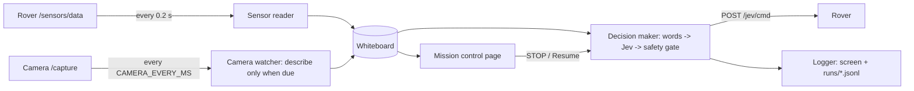

# Earth Station

A Python program on a laptop that lets **Jev** drive the rover. About twice a second it reads the rover's sensors, looks at the latest camera description, asks Jev for the next move, checks it against the safety rules, and sends it to the rover.

Both AP control pages keep working the whole time. Any button pressed on the phone takes the rover out of Jev Auto, and the Earth Station goes quiet.

The design pages in [`docs/design/`](design/) explain the idea with diagrams. Open them in a browser.

---

## Set up on any laptop

You need **Python 3.11+** and **git**. Nothing else: no rover, Jev account or internet is needed to try it.

```sh
git clone https://github.com/Hammad-Sheikhh/mars-rover.git
cd mars-rover
```

| Windows (PowerShell) | macOS / Linux |
|---|---|
| `powershell -ExecutionPolicy Bypass -File scripts\setup.ps1` | `sh scripts/setup.sh` |
| `.\.venv\Scripts\Activate.ps1` | `. .venv/bin/activate` |

The setup script:
1. finds Python 3.11+
2. creates a private environment in `.venv/`
3. installs the Earth Station and its test tools
4. creates `.env` from `.env.example`, unless you already have one

Run the setup again any time to pick up new dependencies.

## Try it with the simulator

```sh
python -m earth_station --sim
```

This starts a fake rover and a fake camera inside the program and lets the mock Jev drive. You should see something like:

```
Earth Station pre-flight
  OK  rover http://127.0.0.1:52811 | camera http://127.0.0.1:52812
  OK  Jev mock | describe mock
  OK  rover answering | mode jev | distance 150 cm
  OK  camera answering | 0.1 KB | "Open floor ahead, nothing close."
  OK  Jev answering | 0 ms
  OK  logging to runs/2026-10-04_232152.jsonl
rover already in Jev Auto
23:21:52.786 #1     forward     0.92  -> sent, rover ok
23:21:55.827 scene  "Cardboard box about 74 cm ahead. Open floor to the right."
23:21:56.312 #7     turn_right  0.91  -> sent, rover ok
```

Press `Ctrl+C` to stop. It sends a final `stop` to the rover and prints a summary.

## Mission control page

Every run (not `--check`) opens `http://127.0.0.1:8000` in your browser. `--no-browser` skips opening it; the address is printed either way.

* **What it shows:** the latest camera photo and its description, the sensor readings, the rover's mode, Jev's last choice with the chance it gave each move, what the safety gate did and what the rover answered, whether each link (rover, camera, vision, Jev) is OK, and the run's totals. It updates twice a second.
* **STOP** (or the `Esc` key): sends `stop` to the rover at once and pauses Jev. An answer Jev was still working on is dropped, not sent. The rover's own watchdog stops it within 1.5 s anyway once moves stop arriving.
* **Resume**: Jev may drive again (still only while the rover is in Jev Auto).
* **Simulator photos** are pretend JPEGs with no picture in them, so the page says the photo can't be shown and shows the description only.
* **Only this laptop** can use it: it listens on `127.0.0.1`, answers only to `127.0.0.1` / `localhost`, and STOP/Resume need an `X-Mission-Control: 1` header that pages from other websites can't send.
* If port 8000 is taken (for example by a second Earth Station), the run goes on without the page and says so. Set `MISSION_CONTROL_PORT` in `.env` to use another port.

| Address | What it does |
|---|---|
| `GET /` | The page |
| `GET /state` | Everything the page shows, as JSON |
| `GET /photo` | The latest camera JPEG |
| `POST /stop` | Stop the rover and pause Jev (needs the header) |
| `POST /resume` | Let Jev drive again (needs the header) |

To act as "the phone" while it runs, start the simulator on its own:

```sh
python -m earth_station.sim                    # terminal 1: fake rover :8081, camera :8082
python -m earth_station                        # terminal 2: uses the defaults in .env
curl "http://127.0.0.1:8081/mode?set=manual"   # terminal 3: press a phone button
curl "http://127.0.0.1:8081/mode?set=jev"      #             press Jev Auto again
```

## Connect the real Jev

This works with the simulator, so you can do it before you have the rover.

1. Get a key: sign in at [console.typesafe.ai/keys](https://console.typesafe.ai/keys) and create an API key. Copy it.
2. Open `.env` in the repo folder and set:
   ```sh
   JEV_MODE=live
   JEV_API_KEY=<paste your key here>
   ```
   Save the file. `.env` never goes to GitHub, so the key stays private. Never paste it into code, issues or chat.
3. Test the key with **exactly one** Jev call (internet needed, no rover):
   ```sh
   python -m earth_station --check --sim --live-jev
   ```
   Look for `OK  Jev answering | <time> ms`.
4. Let the real Jev drive the fake rover:
   ```sh
   python -m earth_station --sim --live-jev
   ```
   The pre-flight shows `Jev live | ... | at most 20 Jev calls`, and each decision line is now the real Jev's choice.
5. **Spending guard.** Each Jev call uses credits, so:
   - `--sim` on its own always uses the pretend Jev. Practice runs are free; only `--live-jev` spends.
   - A run makes at most `JEV_MAX_CALLS` calls (default 20, including the pre-flight test; about 10 seconds of driving). Then it stops the rover, ends by itself and prints `Jev used 20 of 20 calls | ... tokens in, ... out`. Raise `JEV_MAX_CALLS` in `.env` when you want longer runs.
   - The tests never call the real Jev.
6. If it fails, the pre-flight line says why: `rejected the API key` means the key is wrong, and `rate-limited` means wait a moment and try again. To go back to the offline stand-in, set `JEV_MODE=mock`.

The request and reply follow TypeSafe's [API reference](https://docs.typesafe.ai/api). The tests in `tests/test_jev_client.py` check our code against its examples.

## Run it with the real rover

1. Put the rover, the camera and the laptop on **the same phone hotspot**. Type its name and password once in `.env` (`WIFI_SSID`, `WIFI_PASS`, plus `ROVER_AP_PASS` and `CAM_AP_PASS`), then run `python -m earth_station.secrets`. It writes both boards' `secrets.h` from `.env` and makes the shared `ROVER_CMD_TOKEN`.
2. Flash `rover1` firmware 2.1 or newer (it has Jev Auto) and `cam1` firmware 2.1 or newer (it has `cam.local` and `/id`).
3. Leave `ROVER_URL` and `CAMERA_URL` empty: the Earth Station **finds the boards itself** (see [Finding the boards](#finding-the-boards)). If a board isn't found, set its URL to the IP address it prints on its Serial monitor at boot.
   Then run `python -m earth_station --check`: every line should say OK.
4. Start in **suggest-only** mode first. It decides and logs, but never moves the rover:
   ```sh
   python -m earth_station --suggest
   ```
5. Press **Jev Auto** on the rover's AP page and watch what Jev would do while you drive by hand.
6. When you trust it, run `python -m earth_station` and let it drive, slowly and in an open space.

To test the link without any AI (build step 1), send single moves by hand:

```sh
python -m earth_station.drive forward
python -m earth_station.drive turn_left --ms 300 --speed 150
python -m earth_station.drive stop
```

## Finding the boards

Nobody types an IP address. Before it starts, the Earth Station (and `--check` and `earth_station.drive`) looks for each board in this order, and the first hit wins:

1. **The address in `.env`** (`ROVER_URL` / `CAMERA_URL`), if you set one.
2. **The simulator on this laptop** (`python -m earth_station.sim`, ports 8081 and 8082).
3. **Its name**, `rover.local` / `cam.local`. The Earth Station sends its own mDNS question ("who is rover.local?") and the board answers with its address, so this works the same on Windows, macOS and Linux. If nobody answers, it asks the operating system as well.
4. **A network scan**: it asks every address on the laptop's network (a /24, about 254 addresses, 64 at a time) for `GET /id`.

A board only counts if its `/id` says which board it is, so the scan can't mistake the camera, or a printer, for the rover. Finding takes a few seconds when the name works, and about 10 seconds when nothing is found. When it fails, the message lists every place it looked. Some phone hotspots keep devices from seeing each other: then neither the name nor the scan can work, and you can put the address from the Serial monitor in `.env`, or use a different phone (see [SPEC.md](../SPEC.md), open questions).

The code is in `earth_station/finder.py` and `earth_station/mdns.py`, and `tests/test_finder.py` proves each step against the simulator.

## Settings (`.env`)

Every setting has a working default for the simulator. See `.env.example` for the full list.

| Setting | Default | Meaning |
|---|---|---|
| `ROVER_URL` / `CAMERA_URL` | empty | Board addresses. Empty means "find it"; set one only if the finder can't |
| `ROVER_CMD_TOKEN` | `sim-token` | Shared secret for `/jev/cmd`. Must match the rover's `secrets.h` |
| `JEV_MODE` | `mock` | `mock` = offline stand-in, `live` = real Jev API (needs `JEV_API_KEY`) |
| `JEV_API_KEY` | empty | Your key from [console.typesafe.ai/keys](https://console.typesafe.ai/keys) |
| `JEV_API_URL` / `JEV_MODEL` | `https://api.typesafe.ai/v1/systemone` / `jev-latest` | Usually leave as they are |
| `DESCRIBE_MODE` | `mock` | `mock` = no live vision: the simulator's hidden scene, or for a real photo "no camera vision, use the distance sensor". `live` = a vision AI describes each photo (needs `VISION_API_KEY`) |
| `VISION_PROVIDER` | `anthropic` in code, `gemini` in `.env.example` | Which vision AI to use: `gemini` (free key from [aistudio.google.com](https://aistudio.google.com)) or `anthropic` (Claude, paid) |
| `VISION_API_KEY` | empty | The key of the provider above (Gemini or Anthropic) |
| `VISION_MODEL` | `claude-opus-5-5` | Which model describes the photos. For Gemini use `gemini-3.5-flash` (validated on the real camera: 3–12 s per photo). Avoid the `*-lite` and `*-latest` aliases; they took 19–50 s or timed out |
| `VISION_FOCUS` | empty | Comma-separated objects the vision AI should watch out for (e.g. `cables on the floor, stairs or drops`). Added to the photo prompt for either provider |
| `VISION_EFFORT` | `low` | Anthropic only: how hard Claude thinks: `low`, `medium`, `high`, `xhigh` or `max`. Higher is slower and costs more |
| `VISION_TIMEOUT_S` | `30` | Give up on one photo after this many seconds (the scene goes stale and the gate stops the rover). Gemini 3.5 Flash takes 7–12 s |
| `VISION_MAX_CALLS` | `6` | Most real descriptions in one run, including the pre-flight photo. One description is reused for many decisions; `mock` vision is free and not counted |
| `VISION_REFRESH_MS` | `12000` | Ask for a new description when the current one is this old (the hard forward limit is `SCENE_MAX_AGE_MS`) |
| `VISION_REFRESH_MOVES` | `14` | ... or after this many movement steps. A turn counts as 6, so two turns plus two forward steps reach it |
| `VISION_CLOSE_CM` | `60` | ... or when something this close is at least 20 cm closer than in the photo (a chair leg appearing) |
| `VISION_LOST_STOP_S` | `60` | If no description succeeds for this long, stop the rover and end the run cleanly instead of waiting forever |
| `CAMERA_EVERY_MS` | `3000` | How often the camera watcher looks. A photo is captured every time; a description is only asked for when a refresh rule says so. The real description period is this plus the describe time (7–12 s on Gemini 3.5 Flash) |
| `SCENE_MAX_AGE_MS` | `20000` | Hard limit: refuse to drive **forward** on a description older than this. Turns and reverse are still allowed by the gate |
| `SCENE_MAX_MOVES` | `24` | Hard limit: refuse to drive forward after this many movement steps on one description (a turn counts as 6) |
| `DECIDE_EVERY_MS` | `50` | How long to wait after each Jev answer. `50` chains the 500 ms move pulses (continuous motion); `500` halves the Jev spend but makes the rover stop-start |
| `JEV_MAX_CALLS` | `20` | Most real Jev calls in one run (pre-flight included). Then the station stops the rover and ends the run. Only counts with `JEV_MODE=live` |
| `MIN_CONFIDENCE` | `0.60` | Below this, the gate sends `stop` — except `reverse` when something is closer than `SAFE_DISTANCE_CM` (backing off only adds clearance) |
| `SAFE_DISTANCE_CM` | `40` (45 in `.env.example` after 22 Oct) | Forward is refused below this distance. A negative `distance_cm` means "no echo within ~2 m", which counts as clear |
| `TELEMETRY_EVERY_MS` | `1000` (code default `200`) | How often the rover is polled. Keep it at 1000 until firmware 2.6.0: ~4 requests/s hung the rover's web server on 22 Oct |
| `TELEMETRY_MAX_AGE_MS` | `500` (2500 in `.env`) | Older than this means `stop`. Must sit well above `TELEMETRY_EVERY_MS`, or every other decision trips it |
| `MAX_SPEED` / `MOVE_MS` | `255` / `500` | Speed cap (0–255) and length of each move. Full power and the firmware's cap are needed for the 2–3 kg rover; a single pulse still barely moves, so Jev chains them |
| `GOAL` | `explore the room safely` | Put into every message Jev reads |
| `MISSION_CONTROL_PORT` | `8000` | Port of the mission control page, `http://127.0.0.1:<port>` |

Gemini's free tier is **20 requests/day per model** (measured 2026-10-20). A pre-flight plus a 10-call drive can use it up; `VISION_MAX_CALLS=6` caps a run at 6 (pre-flight included), and the station reuses the last description for every decision in between. For a longer vision drive, enable billing or use `DESCRIBE_MODE=mock`.

Keys live only in `.env`, which is git-ignored. Never put them in code.

## How it works



| File | Job |
|---|---|
| `earth_station/__main__.py` | Command line, pre-flight, clean shutdown |
| `earth_station/station.py` | The workers and the decision cycle, including the vision budget and clean stop |
| `earth_station/whiteboard.py` | Shared notebook, with a timestamp on every value |
| `earth_station/links.py` | HTTP to the rover and camera |
| `earth_station/describe.py` | Photo → short description (Gemini or Claude vision, or the mock) |
| `earth_station/vision_policy.py` | When a new description is worth a vision call, and when one is too old to drive forward |
| `earth_station/state_text.py` | Numbers → plain words for Jev |
| `earth_station/jev_client.py` | Jev API client, plus the mock policy |
| `earth_station/safety_gate.py` | The laptop-side safety rules |
| `earth_station/logger.py` | Console output and the JSONL run log |
| `earth_station/mission_control.py` | Serves the mission control page; STOP and Resume |
| `earth_station/mission_control.html` | The page itself (no internet needed) |
| `earth_station/sim.py` | Fake rover and camera |
| `earth_station/drive.py` | Send one move by hand |

### Vision cost control

A description costs quota or money; a Jev decision is cheap and happens every 50 ms. One description therefore serves many decisions, and the station asks the vision AI for a new one only when:

* there is no description yet (the pre-flight photo),
* the rover moved `VISION_REFRESH_MOVES` steps since the photo (a turn counts as 6),
* the description is `VISION_REFRESH_MS` old,
* something within `VISION_CLOSE_CM` is at least 20 cm closer than in the photo,
* Jev was unsure (below `MIN_CONFIDENCE`) on an older description.

Every live attempt counts against `VISION_MAX_CALLS`, including the pre-flight photo, timeouts and rate-limited attempts, because those may still use quota. When the budget is spent the station keeps driving on the last description; the hard limits above then stop it if that description gets too old. It ends the run cleanly — it stops the rover and prints why — instead of waiting forever. The same clean stop happens after `VISION_LOST_STOP_S` without a successful description.

Mission control shows `Vision calls: X used, Y left of Z` and warns when the budget is spent or the run gives up. With `DESCRIBE_MODE=mock` it shows `off (Jev drives on the sensors only)`.

The prompt tells the vision AI what the rover can physically do: about 15 cm wide and 20 cm tall, a gap of ~25 cm or wider is passable, and floor you can see under or around an object means the way is open. Without that, "blocked within 1 m" turned every passable gap into a wall (22 Oct: a bed frame with a clear gap stopped the rover for a whole run).

### What Jev is told

`state_text.py` turns the readings into short conclusions, because Jev is weak at arithmetic: the goal, the distance in words ("62 cm, clear (safe distance is 40 cm)"), the orientation ("level (pitch 3 deg)"), the terrain, the camera description with its open side and hazards, and the previous move.

Only conclusions that are true right now are passed on. The firmware keeps an event for 8 s, so one wheel bump used to be reported as `Recent event: Tilt Warning` long after the rover was level again — on 22 Oct that reached Jev on **164 of 171** decisions, and it hedged (`forward 0.50 / stop 0.33`) until the gate stopped half the forwards. A tilt warning is now passed on only when the orientation line also says tilted; otherwise Jev reads "a bump spiked the tilt sensor while driving; the rover is level again now".

### Safety gate rules

The rules, in order:

1. Only drive when the rover reports `mode: "jev"`. Otherwise send nothing.
2. Telemetry older than `TELEMETRY_MAX_AGE_MS` means `stop`.
3. **Forward** with a description older than `SCENE_MAX_AGE_MS`, or more than `SCENE_MAX_MOVES` steps since the photo, means `stop` (`camera description too old` / `camera view is out of date`). Turns and reverse are still allowed at the gate. While the view is stale the station also stops asking Jev, so the rover waits rather than drives blind.
4. **Forward inside `SAFE_DISTANCE_CM`** means `stop` (`only 36 cm ahead (safe distance is 45 cm)`). The rover's own veto is 20 cm, which is too late: on 22 Oct it pushed into a stool twice at 18–36 cm. A negative distance ("no echo within ~2 m") stays drivable.
5. Jev under `MIN_CONFIDENCE` means `stop` — **except `reverse` while something is closer than `SAFE_DISTANCE_CM`**, which is approved (`reversing away from an obstacle`). Backing off only adds clearance, and Jev's five-way answer often splits reverse from stop (0.48 at 18 cm left the rover pinned).
6. Jev chooses `forward` but itself says the path is blocked: `stop`.
7. Jev chooses `stop`: the rover stops (approved).
8. Speed is capped at `MAX_SPEED`, and each move lasts `MOVE_MS` (max 500).
9. Any error (Jev, camera or rover) means `stop`.

The rover has its own second layer: the obstacle and tilt vetoes, and the watchdog.

### Getting unstuck

When forward is refused because the gap is too small — by the gate above, or by the rover's own 20 cm veto — the station runs a short manoeuvre instead of shuffling between forward and reverse:

1. **Reverse** once for 500 ms.
2. **Measure** the distance again. If it is now `SAFE_DISTANCE_CM` or more, the rover has room and Jev decides again.
3. If the room did not improve, **pivot** three 500 ms steps (about 90°) toward the camera's open side, then hand back to Jev with a fresh view.
4. After three manoeuvres in a row without room, it **stops** and prints that the rover needs a hand, rather than grinding against furniture.

Each step waits for the move to finish before the next is sent: a new `/jev/cmd` replaces the move that is running, so three turns sent 90 ms apart only turned the wheels for 270 ms in total — and the distance check ran before the rover had moved at all. The manoeuvre spends no Jev calls, and can run with an old photo because it never drives forward.

You will see this in the log as `recovery: not enough room ahead, so back off and measure the room`, then either `recovery: reversing gained room (36 cm -> 60 cm), handing back to Jev` or `recovery: reversing did not gain room (36 cm -> 39 cm), pivoting 3 steps (turn_right)`. In the run log each step is a normal decision with confidence 0.95 and the line `Recovery: …` at the top of the text Jev would have read.

### Run logs

Each run writes `runs/<date>_<time>.jsonl`, one JSON object per line: every decision with the exact text Jev read, its answer, the gate's verdict and the rover's reply. `runs/` is git-ignored.

## Rover protocol

This is the contract between the Earth Station and the rover. `rover1/rover1.ino` (firmware 2.1) and the simulator (`earth_station/sim.py`) both follow it. Change all three together.

**`GET /id`**: `{"board": "rover", "firmware": "2.5.1"}`. The camera (`cam1`) answers `{"board": "camera", "firmware": "2.2.0"}`. Used to recognise the boards on the network.

**`GET /startjev`**: the **Jev Auto** button on the rover's control page. It switches Jev Auto on or off.

**`GET /sensors/data`**: the existing reply, plus these fields:

```json
{ "distance_cm": 62, "mode": "jev", "pitch": 3.1, "roll": -1.2, "vibration": 0.04,
  "last_event": "Nominal", "temperature": 29.4, "humidity": 41, "...": "..." }
```

* `distance_cm`: latest ultrasonic median, or `-1` if there's no echo.
* `mode`: `"manual"`, `"autonomy"` or `"jev"`. If the field is missing, the Earth Station treats the rover as manual and never drives it.
* `last_event`: `Nominal`, `Obstacle Avoided`, `Tilt Warning` or `Impact Detected`. An event stays in the payload for only 8 seconds (rover firmware 2.5), then goes back to `Nominal` — a finished hazard no longer haunts Jev's briefs.
* `accX`/`accY`/`accZ`: the raw gravity vector (in G) from the MPU6050, the numbers pitch/roll come from. (Firmware 2.5.)
* `i2c_ok` / `i2c_recov` (firmware 2.5.1): `1` means the MPU6050 answered the last I2C handshake; `i2c_recov` counts how often the rover had to re-initialise the I2C bus to bring a stuck IMU back. Rising `i2c_recov` string means a wiring or power problem, not a software one.

**`POST /jev/cmd`**: header `X-Token: <ROVER_CMD_TOKEN>`, body:

```json
{ "seq": 4182, "action": "turn_right", "speed": 170, "duration_ms": 300 }
```

| Reply | When |
|---|---|
| `200 {"ok": true, "seq": 4182, "executed": "turn_right"}` | Move started |
| `200 {"ok": false, "seq": 4182, "refused": "not_in_jev_mode"}` | Rover isn't in Jev Auto |
| `200 {"ok": false, "seq": 4182, "refused": "obstacle_too_close"}` | Forward requested under 20 cm |
| `200 {"ok": false, "seq": 4182, "refused": "tilt"}` | Pitch or roll over 35° |
| `200 {"ok": false, "seq": 4182, "refused": "unknown_action"}` | `action` isn't one of the five |
| `200 {"ok": true, "seq": 4182, "executed": "duplicate_ignored"}` | Same `seq` as the last command (a retry) |
| `400 {"ok": false, "refused": "bad_json"}` | Empty body |
| `401 {"ok": false, "refused": "bad_token"}` | Wrong or missing token |

Rover rules:
* `action` must be one of `forward`, `turn_left`, `turn_right`, `reverse`, `stop`. Clamp `speed` to 0–255 and `duration_ms` to 0–500.
* Ignore a command whose `seq` equals the last one (a retry). Forget the last `seq` when Jev Auto is switched on.
* **Watchdog:** in Jev Auto, if no command has arrived for 1.5 s, stop the motors.
* Run moves without `delay()`. Track the end time with `millis()` so the web server stays responsive.
* Any manual button press (`/startnav`, `/startstop`) leaves Jev Auto.
* While a move runs, the rover keeps checking: it stops early if something comes closer than 20 cm during `forward`, or if it tilts past 35°.

## Tests

```sh
pytest           # 90 tests: safety rules, wording, parsing, finder, photo descriptions, Jev spending guard, mission control, full loop on the simulator
ruff check .     # lint
```

CI runs both on every pull request.

## Not done yet

* **Firmware 2.6.0** ([SPEC.md](../SPEC.md) milestone 11): reject accelerometer spikes far from 1 g, and make the web server survive the station's request rate. Until it is flashed, the station polls telemetry every 1000 ms and hides a `Tilt Warning` that the current orientation contradicts.
* **The acceptance vision drive** ([SPEC.md](../SPEC.md) milestone 12): the free Gemini quota (20/day) was spent on 22 Oct, so the tuned station has not yet been driven on live vision end to end.
* **Rover firmware on hardware.** The code is written and compiles in CI, but it hasn't been tested on the real rover yet.
* **Camera `cam.local` and `/id` on hardware** ([SPEC.md](../SPEC.md) milestone 4). Written (firmware 2.1) and compiled in CI; waiting for the teammate's test.
* **Photo descriptions on real photos** ([SPEC.md](../SPEC.md) milestone 5). The code is done and tested with a fake Gemini/Claude. Still to do: try it with a real Gemini key on photos from the rover camera, and measure speed.
